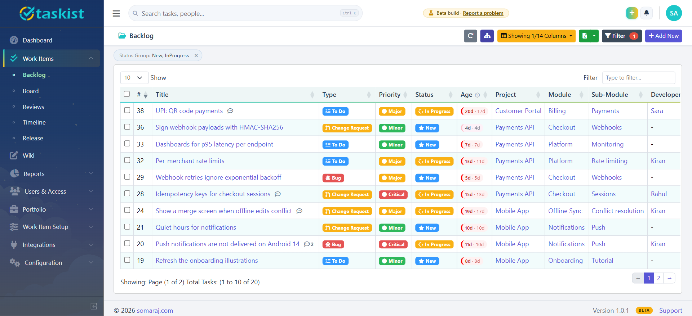
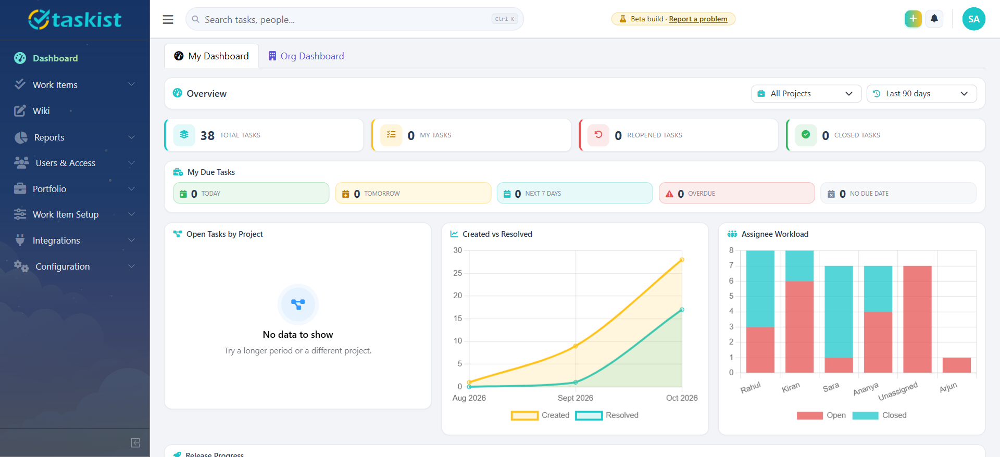
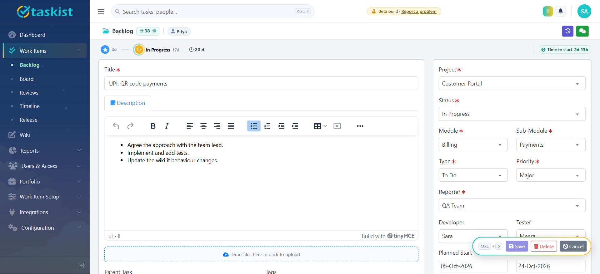
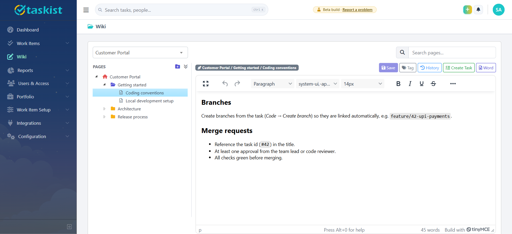
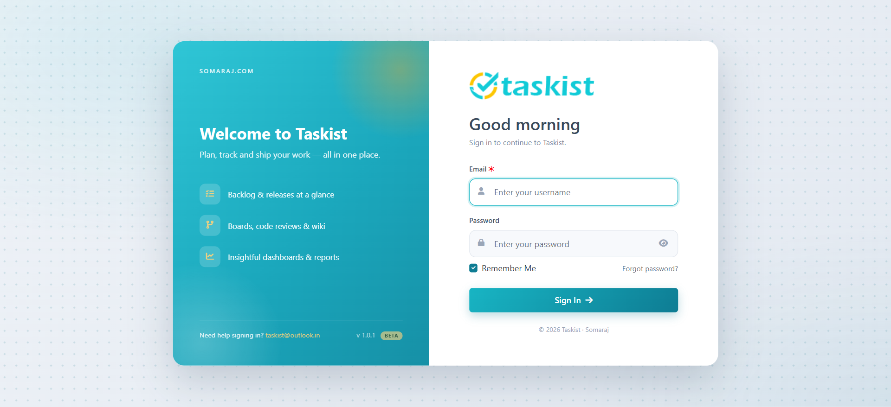

<div align="center">


### Open-source task & bug tracking for software teams

Backlog · Board · Releases · Code reviews · Wiki — self-hosted on .NET and SQL Server

[](https://github.com/Taskist/taskist/actions/workflows/ci.yml)
[](LICENSE)

[](https://github.com/Taskist/taskist/discussions)
[](https://github.com/Taskist/taskist/stargazers)

**[Live demo](https://demo.taskist.org)** · **[Documentation](https://docs.taskist.org)** · **[Quick start](#-quick-start)** · **[Changelog](CHANGELOG.md)** · **[Discussions](https://github.com/Taskist/taskist/discussions)**

<br>



</div>

<br>

Taskist is a self-hosted **task, change request and bug tracker** built with ASP.NET Core MVC and Microsoft SQL Server. Plan work on a backlog and board, ship it in versioned releases, review merge requests from GitHub or GitLab, and keep your team's knowledge in a built-in wiki — without per-seat pricing.

**Why Taskist?**

- **Yours to run** — MIT-licensed and self-hosted; your data stays in your own SQL Server.
- **Code-aware** — branches, merge/pull requests, reviews and issue sync for GitHub and GitLab, cloud or self-hosted.
- **Ready in minutes** — one `docker compose up` gives you the app, the database and a seeded admin.
- **Secure by default** — PBKDF2 passwords, encrypted secrets, permission-checked attachments and hardened outbound requests ([SECURITY.md](SECURITY.md)).

## 📸 Screenshots

<table>
  <tr>
    <td width="50%"><br><sub><b>Dashboard</b> — due tasks, workload and trends at a glance</sub></td>
    <td width="50%"><br><sub><b>Task editor</b> — status timeline, rich text, sub-tasks and attachments</sub></td>
  </tr>
  <tr>
    <td width="50%"><br><sub><b>Wiki</b> — per-project pages with categories and history</sub></td>
    <td width="50%"><br><sub><b>Sign-in</b> — branded with your company name</sub></td>
  </tr>
</table>

## ✨ Features

<table>
  <tr>
    <td width="50%" valign="top">

**📋 Work items**
- **Backlog** of tasks, change requests and bugs — severity, reporter, tags, attachments, comments, history and a full filter panel
- **Board** and **Timeline** views of the same work
- **Releases** with auto-generated versions from a per-project format (`{major}.{minor}.{patch}`, `{yyyy}.{MM}.{seq}`, …)
- **Closing checklist** — a status can require root cause, resolution or a merge request

</td>
    <td width="50%" valign="top">

**🔗 Code**
- **GitHub and GitLab**, cloud or self-hosted — create branches and merge/pull requests from a task
- **Webhooks** move tasks when merge requests open, merge or close
- **Reviews** — approve, comment, rebase and merge under the reviewer's own account
- **Issue sync** — import, export or two-way

</td>
  </tr>
  <tr>
    <td width="50%" valign="top">

**👥 Team**
- **Wiki** with categories and version history
- **Announcements** with read acknowledgements
- **Chat notifications** to Teams, Slack, Google Chat, Discord, Mattermost or any JSON webhook
- **Reports** — task explorer, resource load, stage duration and Excel export

</td>
    <td width="50%" valign="top">

**⚙️ Administration**
- Users, roles and fine-grained permissions
- Masters for clients, projects, modules, statuses, task types, severities, tags and reporters — shared or per project
- Database-driven translations, e-mail templates and settings
- Light, dark and system themes with an accent colour per user; activity log; background-jobs dashboard

</td>
  </tr>
</table>

**Built with** ASP.NET Core MVC (.NET 10) · EF Core 10 · SQL Server 2019+ · Hangfire · Mapperly · FluentValidation · CoreUI + Bootstrap 5 · ClosedXML — every front-end library vendored locally, no CDN.

## 🚀 Quick start

Requires [Docker Desktop](https://www.docker.com/products/docker-desktop/) or Docker Engine with Compose v2.

```bash
git clone https://github.com/Taskist/taskist.git
cd taskist
cp .env.example .env        # then set a strong MSSQL_SA_PASSWORD
docker compose up -d
```

Open **http://localhost:8080** and sign in as **`admin@taskist.org`** / **`Admin@123`**.

> [!WARNING]
> Change the admin password right after the first sign-in, and never expose the seeded account on a reachable network.

- Set `SEED_DUMMY_DATA=true` in `.env` before the first start for a sample client, project and modules.
- `docker compose logs -f web` follows the logs; `docker compose down -v` deletes everything, including the encryption keys.
- The sample stack serves plain HTTP (`TASKIST_REQUIRE_HTTPS_COOKIES=false`). Put it behind TLS before exposing it — see [Configuration](#configuration).

<a name="local-development"></a>

## 🛠 Local development

**Prerequisites:** [.NET 10 SDK](https://dotnet.microsoft.com/download/dotnet/10.0), SQL Server (Express, LocalDB or Docker), and the EF Core tools (`dotnet tool install --global dotnet-ef`).

1. Clone and restore:

   ```powershell
   git clone https://github.com/Taskist/taskist.git
   cd taskist
   dotnet restore src/Taskist.sln
   ```

2. Create `src/Presentation/Taskist.Web/appsettings.Development.json` (git-ignored):

   ```json
   {
     "ConnectionStrings": {
       "AppContext": "Server=.\\SQLEXPRESS;Database=Taskist;Integrated Security=True;TrustServerCertificate=True;"
     }
   }
   ```

3. Create the schema:

   ```powershell
   dotnet ef database update --project src/Libraries/Taskist.Data --startup-project src/Libraries/Taskist.Data
   ```

4. Run `sql-scripts/02_defaults.sql`, then `03_locale.sql` (see [Database](#database)).

5. Start the app and browse to **https://localhost:7025**:

   ```powershell
   dotnet run --project src/Presentation/Taskist.Web
   ```

In Development, background jobs run inline instead of on a Hangfire server, so webhooks and notifications work without extra setup. Run the tests with `dotnet test src/Taskist.sln` — no database needed.


<a name="configuration"></a>
## ⚙️ Configuration

Taskist reads `appsettings.json`, `appsettings.{Environment}.json`, user-secrets and environment variables; environment variables win. Nested keys use a double underscore: `Security:RequireHttpsCookies` → `Security__RequireHttpsCookies`.

| Setting | Default | Description |
| ------- | ------- | ----------- |
| `ConnectionStrings:AppContext` | — | **Required.** SQL Server connection string |
| `App:BaseUrl` | `https://localhost:7025/` | Public address, used in e-mail links, OAuth callbacks and webhook URLs |
| `Security:RequireHttpsCookies` | `true` | Sign-in cookie over HTTPS only. `false` is for deliberate plain-HTTP setups and also skips HTTPS redirection and HSTS |
| `Security:ForwardedHeaders:Enabled` | `false` | Trust `X-Forwarded-For` / `X-Forwarded-Proto` from a reverse proxy |
| `Security:ForwardedHeaders:KnownProxies` | `[]` | Proxy IP addresses to trust (loopback is always trusted) |
| `Security:ForwardedHeaders:KnownNetworks` | `[]` | Proxy networks in CIDR form, e.g. `172.16.0.0/12` |
| `DataProtection:KeysPath` | `App_Data/DataProtectionKeys` | Encryption key ring folder; must be writable |
| `DataProtection:CertificatePath` / `CertificatePassword` | — | Encrypt the key ring at rest with a PFX certificate |
| `DataProtection:CertificateThumbprint` | — | …or with a certificate from the machine store |
| `DataProtection:ProtectWithDpapi` / `DpapiLocalMachine` | `false` | …or with Windows DPAPI |
| `App:IsBeta` / `App:BetaMessage` | `true` / text | Beta banner |

Everything else — password policy, lockout, session length, e-mail, Git, notifications, report layouts — lives in the app under **Configuration → Settings**.

**Behind a reverse proxy** (nginx, Traefik, IIS, a cloud load balancer): keep `RequireHttpsCookies=true`, set `ForwardedHeaders:Enabled=true` and list the proxy in `KnownProxies` or `KnownNetworks`, and set `App:BaseUrl` to the public `https://` address. In Docker these are `TASKIST_REQUIRE_HTTPS_COOKIES`, `TASKIST_FORWARDED_HEADERS`, `TASKIST_PROXY_NETWORK` and `APP_BASE_URL` in `.env`.


<a name="database"></a>
## 💾 Database

**Schema = EF Core migrations:**

```powershell
dotnet ef database update --project src/Libraries/Taskist.Data --startup-project src/Libraries/Taskist.Data
```

`Taskist.Data` is its own startup project; add `--connection "<connection string>"` to target another database.

**Seed data** lives in [`sql-scripts/`](sql-scripts/) as idempotent scripts, matched on business keys, so re-running them is safe. Run them in numeric order (with `sqlcmd`, pass `-f 65001`):

| Script | Required | Contents |
| ------ | -------- | -------- |
| `01_schema.sql` | Alternative | Full idempotent schema, for when you can't run `dotnet ef` |
| `02_defaults.sql` | ✅ | Language, roles and permissions, menu, task types / severities / statuses, settings, email templates, administrator account (only into an empty user table) |
| `03_locale.sql` | ✅ | English (India) translations |
| `04_demo.sql` | Optional | Sample client, project and modules |

Upgrading? See [UPGRADING.md](UPGRADING.md) and the [changelog](CHANGELOG.md).


## 🔐 Security

Please report vulnerabilities privately as described in **[SECURITY.md](SECURITY.md)**, not as public issues.

Before going live: serve over HTTPS, change the seeded admin password, use a least-privilege SQL login, and **back up the Data Protection key folder** — losing it signs everyone out and makes stored Git tokens, webhook secrets and notification URLs unreadable. SECURITY.md has the full deployment checklist.

## 💬 Community & contributing

| | |
| --- | --- |
| 🙏 **Questions** | [Discussions → Q&A](https://github.com/Taskist/taskist/discussions/categories/q-a) |
| 💡 **Ideas** | [Discussions → Ideas](https://github.com/Taskist/taskist/discussions/categories/ideas) |
| 🐛 **Bugs** | [Open an issue](https://github.com/Taskist/taskist/issues/new/choose) |
| 🛠 **Code** | [CONTRIBUTING.md](CONTRIBUTING.md) — setup, conventions and what CI checks |
| 📖 **Docs** | [docs.taskist.org](https://docs.taskist.org) · [Git integration](docs/git-integration.md) |

By participating, you agree to uphold our [Code of Conduct](CODE_OF_CONDUCT.md).

## 💖 Sponsors & partners

Thanks to the providers who support this project with free licenses and services:

[](https://sentry.io/for/open-source/)
[](https://www.atlassian.com/software/confluence)
[](https://monsterasp.net)
[](https://gitbook.com)

If Taskist helps you, ⭐ star the repository and share it with your team.

## 📄 License

[MIT](LICENSE) © 2025-2026 Somaraj and Taskist contributors. Bundled third-party libraries keep their own licences — see [THIRD-PARTY-NOTICES.md](THIRD-PARTY-NOTICES.md).
